<!--
  Profile README for github.com/reniaz.
  The banner, terminal and footer are animated SVGs generated by gen/*.py
  (Python stdlib only). Regenerate after editing:  python3 gen/build.py
-->

 

**C first, everything else when it's needed.** 
Systems and Linux tinkerer. Deutsch, English, and slowly 日本語. (｡•̀ᴗ-)✧

[About me](#-about-me) · [Projects](#-projects) · [Cooking](#-cooking)

## ✨ About me

<table>
<tr>
<td width="50%">🔧 <b>C first</b> C11, no dependencies if I can help it. I keep sharp on <a href="https://adventofcode.com">Advent of Code</a> and <a href="https://everybody.codes">everybody.codes</a>, solved in plain C.</td>
<td width="50%">🐧 <b>Linux desk</b> Fedora 44 and Hyprland, held together by my own Quickshell bar.</td>
</tr>
<tr>
<td>🤖 <b>Hardware on the side</b> Arduino, a soldering iron and a half-built MSE-6 mouse droid, the one scurrying through the banner.</td>
<td>🗣️ <b>Deutsch · English · 日本語</b> German and English every day, Japanese a little every day (毎日少しずつ).</td>
</tr>
</table>

## 🧰 Projects

<table>
<tr>
<td width="50%">🤫 <a href="https://github.com/reniaz/leise-releases"><b>leise</b></a> <i>de. quiet</i> Community chat that only the people in it can read. I2P only, end-to-end encrypted with MLS + Noise. Rust · Tauri 2 · Svelte 5 · Windows &amp; Linux</td>
<td width="50%">🦡 <a href="https://github.com/reniaz/marder"><b>marder</b></a> <i>de. marten</i> A BitTorrent client written from scratch. No libtorrent, no bencodepy: just the spec and a byte cursor. Python · zero dependencies · work in progress</td>
</tr>
<tr>
<td>🔌 <a href="https://github.com/reniaz/draht"><b>draht</b></a> <i>de. wire</i> A Telegram desktop client with a plugin system and themes, in the spirit of Vencord. TypeScript · Electron</td>
<td>🥁 <a href="https://github.com/reniaz/takt"><b>takt</b></a> <i>de. beat</i> A music player for Windows: local files, a ten-band EQ you shape by drawing on it, nine themes. TypeScript</td>
</tr>
<tr>
<td>🎧 <a href="https://github.com/reniaz/yt-client"><b>ytmc</b></a> A small, fast, audio-only YouTube Music client for the Linux desktop, with a Shazam button. Python · GTK4 · GStreamer</td>
<td>🐭 <a href="https://github.com/reniaz/mse-6-droid"><b>mse-6</b></a> A scratch-built, radio-controlled Star Wars mouse droid with Arduino-driven lights and sound. C++ · Arduino · DFPlayer Mini</td>
</tr>
</table>

## 🍳 Cooking

> [!NOTE]
> Private for now. They go public once they're ready.

| | Project | What it is | Stack |
|---|---|---|---|
| 📻 | **funkstation** | internet radio that looks like it belongs on your desktop | Rust · iced · GStreamer |
| 📺 | **anilist** | a tiny terminal anime tracker: just C and a text file | C11 |
| 🪟 | **rd-shell** | my Quickshell bar and the rest of my Hyprland rice | QML |
| 🎄 | **aoc · ec** | Advent of Code and everybody.codes, one puzzle at a time | C |

